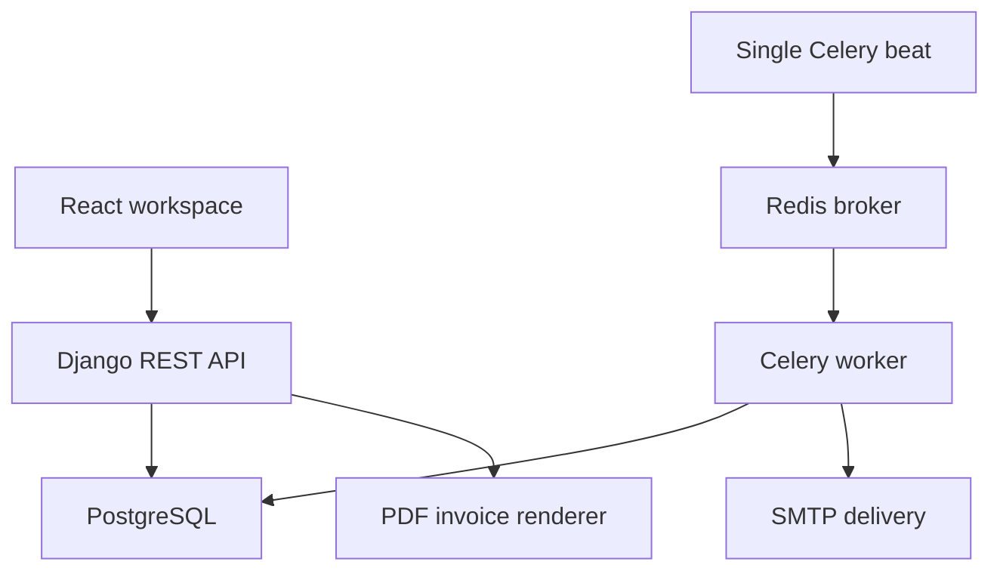

# Architecture

## Components

- Django 5.2 + Django REST Framework expose an authenticated API under `/api/`.
- React + Vite + TanStack Query provide the web workspace. A small native-fetch client manages JWT renewal and CSRF.
- PostgreSQL stores tenant-owned business records. SQLite is supported for single-user development/tests.
- Celery workers consume Redis queues. A single beat process schedules hourly low-stock checks and daily token cleanup.
- Gunicorn runs Django WSGI. WhiteNoise serves the compiled frontend/static files from the production image.

## Tenant isolation

This implementation chooses shared tables with explicit tenant foreign keys rather than schema-per-tenant provisioning. The initial schema sketch’s `domain_url` and `schema_name` were planning placeholders; neither is required for this model.

Identity is resolved from the verified token’s user record on every request. Tenant IDs are never accepted from API bodies or headers. Querysets are scoped before object lookup, and product/supplier input relations are constrained to the current business. Serializer output never exposes another business’s users. A disabled user or tenant loses API access even with an otherwise valid access token.

The database enforces tenant-local case-insensitive SKU/supplier uniqueness, globally case-insensitive email uniqueness, valid quantities/prices and reservation coverage. These constraints complement API validation. Direct ORM scripts must use the domain services and validate tenant relationships; the database does not implement PostgreSQL row-level security.

Business admins are not Django `is_staff` users. Django admin is for platform superusers; operational records are read-only there so stock cannot bypass services. Membership/role changes are made through the business API, which prevents removal of the final active admin.

## Stock and orders

`quantity` means units physically on hand. `reserved_quantity` means units promised to confirmed sales. `available_quantity = quantity - reserved_quantity`.

| Operation | On hand | Reserved | Ledger kind |
| --- | --- | --- | --- |
| Manual adjustment | +/- delta | unchanged | ADJUSTMENT |
| Receive purchase | + ordered units | unchanged | PURCHASE |
| Confirm sale | unchanged | + ordered units | RESERVE |
| Ship sale | - ordered units | - ordered units | SALE |
| Cancel confirmed sale | unchanged | - ordered units | RELEASE |

Every stock change is an atomic service operation. Order transitions lock the order and product rows; product locks are acquired in primary-key order. Insufficient stock aborts the entire transaction, including previously processed lines and ledger entries. Stock cannot fall below existing reservations. Repeating an already-completed transition returns the existing result without another stock change.

Both order-creation endpoints support an optional `Idempotency-Key`. The tenant row serializes duplicate creation attempts. A repeated key with the same JSON content returns the first order; reusing it for different content returns HTTP 409. Clients should retain the key only for retries of the same logical request.

Sales flow: **DRAFT → CONFIRMED → SHIPPED**, or **DRAFT/CONFIRMED → CANCELLED**. A paid order cannot be cancelled until the operator handles its refund externally and records it as unpaid.

Purchase flow: **DRAFT → RECEIVED**, or **DRAFT → CANCELLED**.

## Prices, invoices and analytics

Draft lines preserve the chosen product name, SKU and price. They may be replaced while the order remains draft. Confirmation preserves seller contact/tax details in a JSON snapshot. Renaming a product or business cannot rewrite an existing confirmed invoice. PDFs are generated on demand instead of exposing public files.

Money uses `Decimal` and two places; tax is rounded half-up once per order. The frontend uses decimal.js to match previews to server calculations. Server totals remain authoritative.

Revenue is recognized on shipment, before tax. Draft, confirmed and cancelled orders never contribute. The chart always includes 30 UTC dates with explicit zero buckets. Inventory valuation includes archived products that still have physical stock; low-stock alerts and active-product counts exclude archived products.

## Sessions and jobs

Access tokens live in JavaScript memory for ten minutes. Refresh tokens live in a Secure, HttpOnly, SameSite=Lax cookie in production, scoped to `/api/auth/`; they rotate with database-backed blacklist checks. Cookie-based auth endpoints also require a CSRF token. A single in-flight refresh promise prevents parallel browser requests from rotating the same token twice. Password changes invalidate previous token hashes. Logout blacklists the refresh token; previously issued access tokens can remain valid for their remaining short lifetime.

Low-stock tasks lock qualifying products, send a business-specific message, and record the send time only on successful delivery. Suppression lasts 24 hours. Replenishment above the reorder point clears suppression. SMTP delivery cannot be made exactly-once across a process/network crash; a retry may duplicate a message after the provider accepted it but before the transaction committed.
