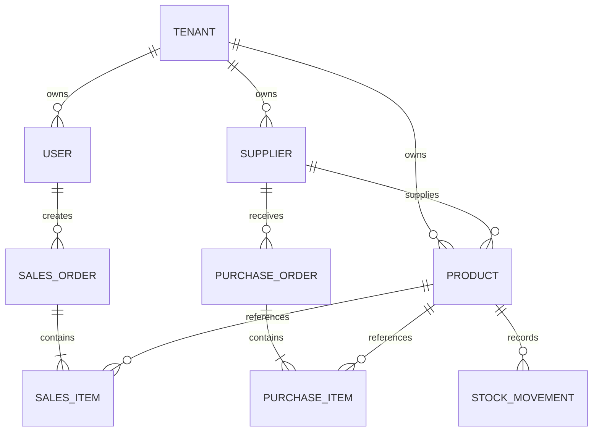

# Database schema

All business entities use UUID primary keys except the custom Django user’s integer key. All tenant-owned records carry a protected `tenant_id`. Timestamped records include `created_at` and `updated_at`.

| Entity | Key fields / behavior |
| --- | --- |
| Tenant | name, fixed currency, billing/contact/tax details, active flag |
| User | globally unique email, hashed password, tenant, Admin/Manager/Staff, active flag |
| Supplier | tenant-local unique name ignoring case, contacts, notes, active flag |
| Product | tenant-local unique SKU ignoring case, supplier, prices, on-hand/reserved/reorder quantities, alert timestamp, active flag |
| StockMovement | product, physical/reserved deltas, resulting balances, actor, order reference and reason; read-only API |
| SalesOrder | customer details, fixed currency, tax, status/payment status, confirmation/shipment times, invoice seller snapshot, idempotency fingerprint |
| PurchaseOrder | supplier relation/name snapshot, fixed currency, tax, draft/received/cancelled state, receipt time, idempotency fingerprint |
| SalesOrderItem | order/product relations, name/SKU/price snapshot, positive quantity |
| PurchaseOrderItem | order/product relations, name/SKU/cost snapshot, positive quantity |
| OutstandingToken / BlacklistedToken | SimpleJWT session rotation and revocation |

Order items may be replaced only while draft. Orders have no delete endpoint; cancellation preserves history. Referenced products/suppliers cannot be deleted; archive them instead. Raw quantities and reservation balances are read-only API fields and can only be changed through stock/order services.

Migrations are committed under each app. The repository intentionally contains no database file, virtualenv, credentials or generated bytecode. A legacy scaffold SQLite database cannot be migrated in place to the new custom-user schema; keep a separate copy of any data you need, create a fresh database and import business data deliberately. Do not reset a database containing real business records.
